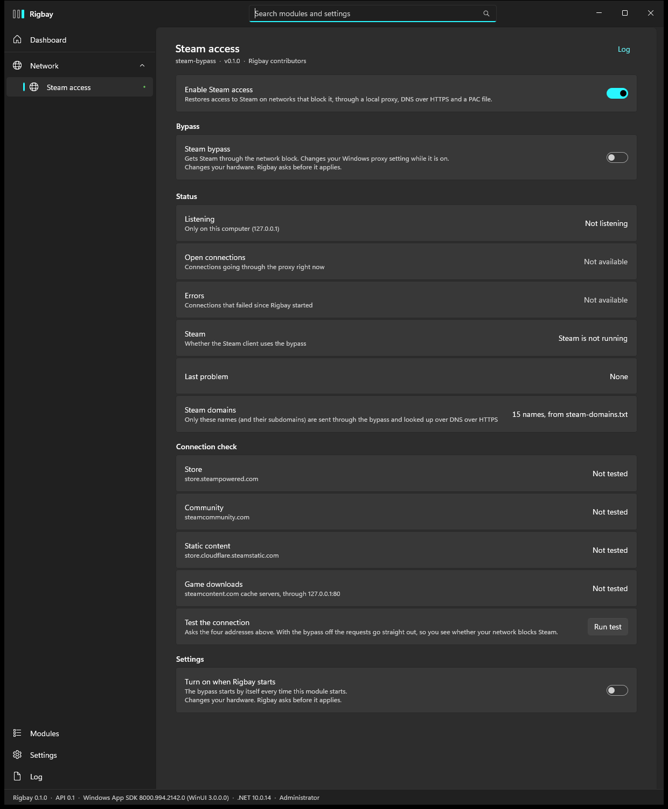
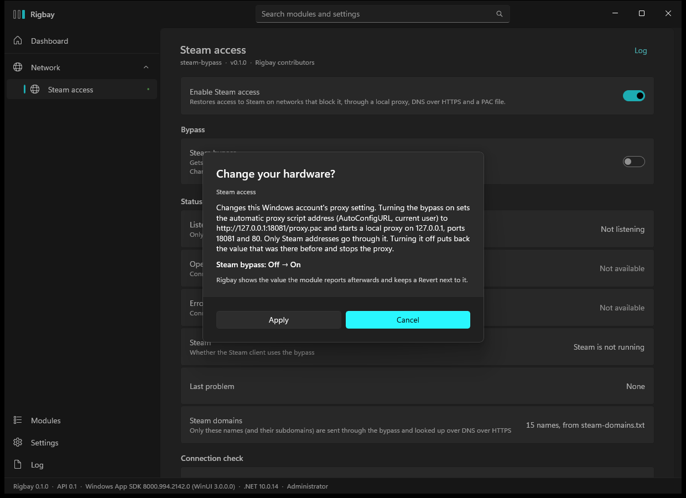

# Steam access module for Rigbay

Restores access to Steam on networks that block it with DNS poisoning plus SNI and HTTP `Host` header filtering. It runs a small proxy on
`127.0.0.1`, looks up Steam names over DNS-over-HTTPS, and points the current user's Windows proxy setting at a PAC file that sends only Steam
addresses to it. Module id `steam-bypass`.

This is a module for [Rigbay](https://github.com/rigbay-app/rigbay), a Windows app that manages modules for your own machine.
Version 0.1.0, early development: there is no release and no package. It is the module port of the standalone app
[steam-bypass](https://github.com/minhdevtree/steam-bypass) (same technique, same domain list format, new code).



## Read this before you turn it on

- **The real thing was never run by the author.** Turning the bypass on for real (the registry write and the two listeners on ports 18081
  and 80) has not been done on a real machine with this module. Everything below that is not listed under "Verified" is untested. Nothing here
  proves that it gets you into Steam on your network.
- **It changes a Windows setting.** While the bypass is on, the current user's
  `HKCU\Software\Microsoft\Windows\CurrentVersion\Internet Settings\AutoConfigURL` is `http://127.0.0.1:18081/proxy.pac`. The value that was
  there before is saved first and put back when you turn the bypass off, disable the module or close Rigbay. If Rigbay is killed with the
  bypass on, the next start of the module puts it back; until then Windows points at an address with nothing behind it (see "If something
  goes wrong").
- **It cannot run together with the standalone Steam Bypass app.** Both use the same ports (127.0.0.1:18081 and :80) and the same PAC address.
  Run one at a time. If the old app is running, the module shows "Port 18081 is already in use" and writes nothing; it also never undoes a
  setting that another program made.
- **Rigbay asks first.** Turning the switch on shows the exact change and asks. The host's dialog is titled "Change your hardware?" because
  that is the only approval path a page row has; the text under it is specific to this module.



## What it does

- Page: the switch **Steam bypass**, status rows (listening, open connections, errors, whether Steam uses it), a four-row **connection
  check** with **Run test**, and **Turn on when Rigbay starts** (off by default; turning it on counts as the approval for every later start).
- Command line: `rigbay steam-bypass status | on | off | test`. `on` and `off` ask for confirmation like any change; `status` and `test` only read.
- Metrics on the host's bus while the bypass is on: `steam.proxy.active` (open connections) and `steam.proxy.errors`.
- Restart Steam after turning the bypass on: it reads the proxy setting only when it starts.
- Only the names in `steam-domains.txt` (and their subdomains) go through the bypass and are looked up over DNS-over-HTTPS. Put a file of the same
  name in the module's data folder to use your own list. The proxy accepts only those hosts and listens on loopback only.

## What it changes on your computer

Only while the bypass is **on**, and only after you confirm in Rigbay:

- the registry value above (current user only, no administrator rights needed for it);
- it listens on `127.0.0.1:18081` (proxy and PAC) and `127.0.0.1:80` (Steam's game downloader), loopback only, never another address;
- Steam host names are sent to `1.1.1.1`, `8.8.8.8`, `cloudflare-dns.com` or `dns.google` over HTTPS. Nothing else is sent anywhere. No telemetry.

It writes a small state file (the saved previous value) to `%LOCALAPPDATA%\Rigbay\modules\steam-bypass\proxy-state.json`.

## Verified and not verified

**Verified** (2026-11-01, one machine, Windows 11, Rigbay 0.1.0 host elevated):

- `dotnet build` of the solution: 0 warnings, 0 errors, in a fresh `git clone --recurse-submodules`. `dotnet test`: 248 tests pass. The tests use
  fakes for the Windows setting, DNS-over-HTTPS and the upstream servers; the registry code runs against a scratch key under
  `HKCU\Software\RigbayTests\` that each test removes; the engine runs on real loopback sockets on free ports (never 80 or 18081), including
  21 hostile inputs and 60 random byte streams.
- The built module was loaded by the real Rigbay app: the page, the dashboard bay, the English and Vietnamese texts and the approval dialog
  were rendered and looked at (`docs/evidence/`). The dialog was opened and nobody answered it.
- While the standalone Steam Bypass app was running on that machine, loading the module, opening its page and running `status` left the old
  app's setting untouched (read before and after).
- A manifest error that the unit tests had not caught was found by loading it in the real host and is fixed.

**Not verified:**

- The bypass **turned on for real**: a real `AutoConfigURL` write and real listeners on ports 18081 and 80. The same code ran against a scratch
  registry key and fake listeners, and the engine against real sockets on other ports.
- The real network: DNS-over-HTTPS to the four endpoints (tested with a fake handler), the real Steam servers, the TLS split against a real
  filter (tested: the upstream sees a 2-byte first segment, then the rest), whether your provider's blocking behaves like the one the design was
  measured against (October 2026, one network).
- A live Steam client: the five Steam states are tested on a fake probe, and the TCP-table code that tells whether Steam uses the proxy has not
  run against a real Steam. Game download speed was not measured (the old app's loops are copied).
- **Run test** and `rigbay steam-bypass test` against the real network; `on` and `off` through a real running host (a headless run is refused,
  nobody can answer).
- A crash or kill of Rigbay with the bypass on (the cleanup at the next start is tested with two managers over one state file and the scratch
  key), sleep and resume, Windows 10, 125 % and 150 % scaling, high contrast, screen readers, other providers.
- A host that is elevated with a different account than the signed-in user: HKCU would be the other account's hive, and the setting would be
  written for the wrong user.

The long version, with the design and the layers, is in [docs/MODULE.md](docs/MODULE.md).

## If something goes wrong

If Windows still points at `http://127.0.0.1:18081/proxy.pac` and nothing runs, the previous value (if there was one) is in
`%LOCALAPPDATA%\Rigbay\modules\steam-bypass\proxy-state.json`. Put it back, or remove the value:

```powershell
Remove-ItemProperty 'HKCU:\Software\Microsoft\Windows\CurrentVersion\Internet Settings' AutoConfigURL
```

Turning the module off in Rigbay is the unconditional way to switch the bypass off; it needs no approval.

## Supported machines

Windows with Rigbay 0.1 (`hostApi` `>=0.1 <0.2`). The module does not look at the hardware, so any Windows machine passes its probe. It was
built and run only on one machine (an Acer Predator laptop, Windows 11); that is the whole extent of what has been tried.

## Build

Needs Windows and the .NET SDK 8 or newer (the module targets `net8.0`). The host contract (`Rigbay.Abstractions`) comes from the git submodule
`external/rigbay` (a pinned commit of the Rigbay repository), so clone with submodules:

```powershell
git clone --recurse-submodules https://github.com/rigbay-app/module-steam-bypass.git
cd module-steam-bypass
dotnet build Rigbay.SteamBypass.sln --configuration Release
dotnet test  Rigbay.SteamBypass.sln --configuration Release
```

If you cloned without `--recurse-submodules`, run `git submodule update --init`. The tests open loopback sockets on free ports only.

The module folder is the build output: `src\Rigbay.SteamBypass\bin\Release\net8.0\` (`module.json`, `Rigbay.SteamBypass.dll`, `steam-domains.txt`,
`lang\`, the icons). It must **not** hold `Rigbay.Abstractions.dll`; the project reference is set up so that it does not.

## Install into Rigbay

Rigbay loads modules from `%ProgramData%\Rigbay\modules\<id>\`, where the folder name must be the manifest id.

1. Copy the whole build output folder to `%ProgramData%\Rigbay\modules\steam-bypass\`, so that
   `%ProgramData%\Rigbay\modules\steam-bypass\module.json` exists.
2. Start Rigbay as administrator, open the module page; the first time, Rigbay lists what the module says it uses and asks you to accept it.
3. Close the standalone Steam Bypass app if it runs, then turn the module on and the switch on.

The module declares (from `module.json`): no administrator rights of its own; listening on 127.0.0.1:18081 and :80; DNS-over-HTTPS to
the four endpoints above for Steam names; the registry value `AutoConfigURL` of the current user; no services.

## License

MIT, see [LICENSE](LICENSE). Not affiliated with Valve. For lawful personal use.
